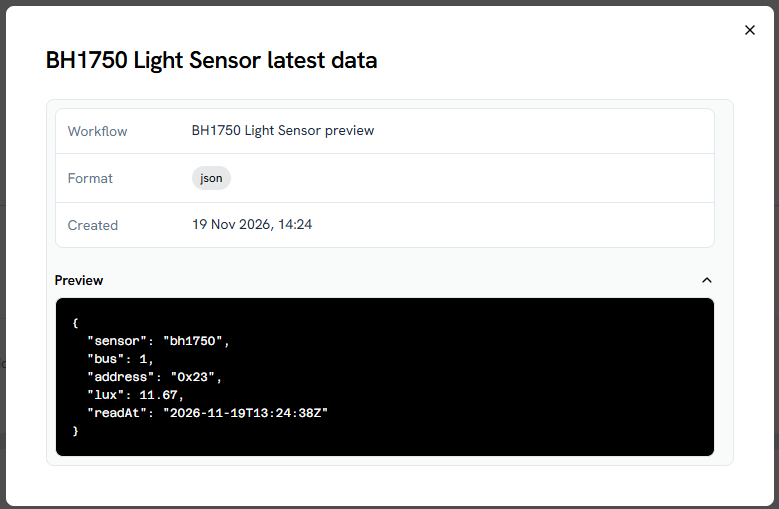

# Adafruit BH1750 Light Sensor Setup

Read ambient light in lux from one **Adafruit BH1750 STEMMA QT / Qwiic, product 4681**, connected directly to the Raspberry Pi I2C header. See the manufacturer's [product page](https://www.adafruit.com/product/4681), [pinout](https://learn.adafruit.com/adafruit-bh1750-ambient-light-sensor/pinouts) and [Pi wiring guide](https://learn.adafruit.com/adafruit-bh1750-ambient-light-sensor/python-circuitpython).

This is a readable input: manual reads and workflow **Fetch data source** blocks save JSON and its hash in Edge Studio. It does not produce light/dark events automatically.

## Requirements and enablement

- An Edge Studio source build containing this integration, on a Raspberry Pi/Linux installation with the existing sensor-helper prerequisites: Python 3, SMBus support, and an enabled I2C interface exposing `/dev/i2c-1`. Use the [contributor quickstart](./contributor-quickstart.md) to run a fork build. This guide does not establish a new Pi/OS compatibility matrix.
- Enable **Devices → Hardware support → I2C sensors**. Follow its automatic or manual prerequisite setup, and reboot when required. The advanced `ENABLE_SENSORS=true` installation shortcut uses the same service.
- On existing installations, use **Repair I2C sensors** after updating the source/runtime. This restarts the helper and installs `smbus2` alongside the existing BME680 dependency in `/opt/edge-studio/.venv-sensor-helper`. It preserves the helper token and existing environment. The backend container does not need an I2C device mount.
- A helper capability reporting `bh1750` means the driver is installed, not that a sensor was detected. A missing dependency, stopped helper or disconnected sensor must be resolved before readings work.

## Wiring

Power off the Pi before connecting wires. Use **physical header pin numbers** in this table and match the labels on the Adafruit board.

| BH1750 pin | Raspberry Pi header |
| --- | --- |
| VIN | 3.3V, physical pin 1 |
| GND | Ground, physical pin 6 |
| SCL | GPIO3 / SCL, physical pin 5 |
| SDA | GPIO2 / SDA, physical pin 3 |
| ADDR / AD0 | Leave at its default for `0x23` |

STEMMA QT carries the same power and I2C signals; a correctly wired QT-to-header cable may be used. The board's `3Vo` pin is a regulator output, not the VIN connection. Use 3.3V for this Pi wiring.

The address is `0x23` by default. Pulling ADDR high to 3.3V or bridging the board's address jumper changes it to `0x5c` (`0x5C` in Adafruit's documentation). For one unmodified sensor, keep `0x23`.

## Add, read and edit

1. Open **Devices → New device → Sensors → Template devices → BH1750 Light Sensor**. If the card is hidden, enable I2C sensors in Hardware support first.
2. Give the device a name. Keep bus `1` and address `0x23` for the wiring above.
3. Review and add the device, then open its setup guide.
4. Use the device's manual read action. Confirm the latest preview, hash and read-history entry are saved.
5. Shade the sensor and read again, then expose it to light and repeat. Confirm the light value changes. **Zero lux is valid in darkness.**
6. Edit the saved device to change its name, bus or address. Editing keeps the device ID and its workflow references/history. Change the address only when it matches the board wiring/jumper.

An illustrative reading (not physical test evidence):

```json
{
  "sensor": "bh1750",
  "bus": 1,
  "address": "0x23",
  "lux": 240,
  "readAt": "2026-11-19T00:00:00Z"
}
```

The helper uses one-shot high-resolution mode with the standard measurement time. Readings have nominal 1-lux resolution; the JSON value is rounded to two decimal places, which does not imply that accuracy. There is no optical-window calibration, automatic ranging or exposure setting. A full-scale reading (about 54,612.5 lux at these settings) may be saturated rather than an accurate measurement of brighter light.

## Workflows

The in-app guide can create a **disabled** starter workflow: **Manual run → Fetch data source → Show preview**, referencing the saved sensor. Existing guide-action handling avoids duplicate creation. Review it, run manually and confirm the saved reading and Workflow Inbox preview.

For regular readings, replace the manual start with **Schedule**, select an interval such as 60 seconds, save and enable the workflow. Confirm scheduled read-history entries and previews. Reads use the same helper and JSON hashing as manual reads. Integritas is optional; light readings do not require stamping.

## Troubleshooting

- If `/dev/i2c-1` is absent, follow Hardware support's I2C setup instructions and reboot if required.
- If available, run `i2cdetect -y 1` on the Pi with workflows stopped. Expect `23` for the default address or `5c` when ADDR is high. A detected address alone does not identify the chip.
- If a read fails, check 3.3V power, common ground, SDA/SCL wiring and the saved bus/address. Do not substitute a BME address (`0x76`/`0x77`).
- If the helper lacks BH1750 support, use **Repair I2C sensors** and check its service logs if repair fails. An offline package index can prevent dependency installation; retry repair after connectivity is restored.
- If concurrent manual/workflow reads occur, the helper serializes BH1750 measurements. Avoid unnecessarily rapid polling; the existing helper request timeout still applies.
- Read failures remain failures in read history; they are not replaced with a fabricated zero-lux value.

## Verification status

### Contributor-reported prototype test

On 2026-11-19, the contributor installed the fork's source build on a spare/test Pi and reported the integration "fully working in every way". The assistant did not independently access or operate that Pi.

| Item | Reported setup / evidence |
| --- | --- |
| Sensor | One Adafruit BH1750 STEMMA QT / Qwiic, product 4681, direct Pi I2C |
| Pi | Raspberry Pi 4 Model B Rev 1.4 |
| OS | Debian GNU/Linux 13 (trixie), `DEBIAN_VERSION_FULL=13.6` |
| Architecture | `aarch64` |
| Installed source commit | `e8fbe5329a218f5d9d43354a534f1bbf57d9a95d`, matching the pushed fork branch |
| Source identity check | Contributor supplied output from `sudo git -C /opt/edge-studio rev-parse HEAD` |
| Visible result | The saved screenshot below shows a Workflow Inbox JSON preview from `BH1750 Light Sensor preview`, with `sensor: bh1750`, bus `1`, address `0x23`, `lux: 11.67` and `readAt: 2026-11-19T13:24:38Z` |



The contributor supplied this image for publication after an earlier chat screenshot showed 12.5 lux at 13:22:58 UTC. The visible crop contains the generic workflow/device name, light reading, sensor bus/address and timestamps; no credentials, wallet details, hostnames, IP addresses or personal names are visible.

After reviewing the physical checklist, the contributor reported "All tests done", following their earlier working-integration report. The checklist covered dark/light response, Devices manual read, scheduled reads, saved-device editing/reopening, I2C disable/re-enable, repeated Repair/settings/token retention and disconnection/recovery. This is an attributed completion statement; individual measurements and per-case logs/outcomes were not supplied, and the assistant did not independently perform those checks.

This records a working physical prototype for the exact setup above, not a complete compatibility matrix. Local Pi source modifications and Compose service output were not supplied. Alternate address `0x5c`, other Pi/OS combinations and calibrated accuracy are not physically verified. The tested Pi source remains the implementation commit above. [Linux PR CI](https://github.com/edge-studio-technology/edge-studio/actions/runs/44534180081) passed `npm run check` and the Python helper/host-setup tests at integration commit `4058467a9d6767b20b8d3dcf3bb6430876aa314e`; later evidence-documentation changes require their own PR checks.

Automated tests separately cover command timing/order, raw two-byte reads, lux conversion, dependency/I/O failures, configuration, API persistence, workflow reads and UI setup/editing. They do not establish physical accuracy or calibrate the sensor.
