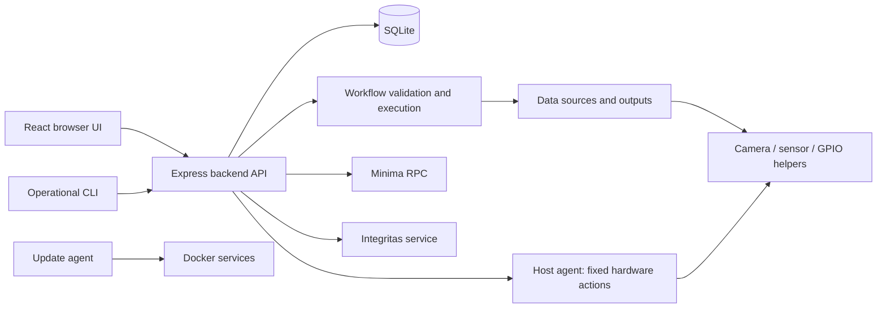

# Edge Studio architecture for contributors

Use this map with [CONTRIBUTING.md](../../CONTRIBUTING.md), [project rules](../../AGENTS.md#project-rules) and the specific integration recipe. This describes the current source-based app, not the deferred Module Builder runtime.

| Area | Code entry points | Responsibility |
| --- | --- | --- |
| App routing/navigation | `frontend/src/App.tsx`, `frontend/src/app/nav.ts` | Authenticated pages and shared shell; no duplicated backend business logic |
| API client | `frontend/src/lib/api.ts` | Session credentials and consistent API errors |
| API startup/routes | `backend/src/index.ts`, `backend/src/startup.ts`, `backend/src/app.ts` | Environment/bootstrap, service startup and route registration |
| Persistence | `backend/src/db/database.ts` and feature repositories | SQLite schema/migrations, saved settings/devices/workflows and history |
| Devices | `backend/src/features/data-sources/`, `frontend/src/features/data-sources/` | Parse saved configuration, read/receive/capture/control, forms and guides |
| Workflows | `backend/src/features/automation/`, `frontend/src/features/automation/workflow/` | Validation, triggers/execution, canvas/configuration and run inspection |
| Host capabilities | `backend/src/features/host-capabilities/`, `host-agent/` | Authenticated, fixed hardware setup/status/actions; root privilege is narrowly exposed |
| Helpers | `camera-helper/`, `sensor-helper/` and GPIO services under `backend/src/features/data-sources/` | Host camera/sensor helpers and GPIO tool integration; inspect the relevant current service before editing |
| Installation/runtime | `install.sh`, `docker-compose.yml`, `.env.example` | Opt-in hardware/helpers, persistent storage, networking and deployment config |
| Updates | `update-agent/`, `scripts/release/` | Signed release delivery and runtime bundle/image production |
| Private feedback | `backend/src/features/feedback/`, `frontend/src/features/feedback/` | Local/consented hosted feedback; never an automatic public-issue bridge |

A **hardware capability** enables infrastructure such as the camera helper. A **configured device** is a saved instance with settings such as pin, sensor model or URL. A **workflow block** uses the device according to its role. Enabling hardware, saving a device and enabling a workflow are separate operations.

The backend owns business logic and validation. The frontend shapes input and explains state but does not call Minima/Integritas directly or hold their server-side secrets. Runtime data lives in SQLite/managed directories; do not add parallel JSON configuration stores or host filesystem access through arbitrary paths. Preserve saved IDs, history, hashes and credentials when changing a supported type.

External operator-supplied HTTP URLs use [the URL policy](../adr/0014-egress-url-policy-for-operator-supplied-urls.md) and `backend/src/shared/http.ts` with its DNS/redirect/size/time/concurrency controls. Host helper URLs are deployment configuration, not arbitrary URLs read from device rows. Do not replace these paths with a bare browser/backend fetch.

Current host access uses narrow helpers and token-protected allowlisted agent actions. Do not add generic shell/file/service endpoints, broaden backend device mounts or enable camera/network listeners by default. See [hardware access ADR](../adr/0019-hardware-access-through-host-helpers.md) and [SECURITY.md](../../SECURITY.md).

Each feature folder owns its API/service/repository/types where applicable. For UI, reuse existing controls under `frontend/src/components/ui/` and layouts under `frontend/src/components/patterns/`, with Tailwind tokens from the [design system](../frontend-design-system.md). Keep validation/loading/error behaviour consistent; inspect a neighbouring implementation rather than duplicating a new framework.
