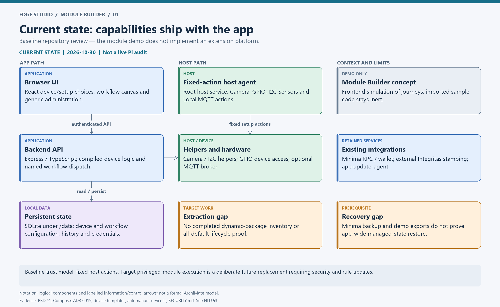
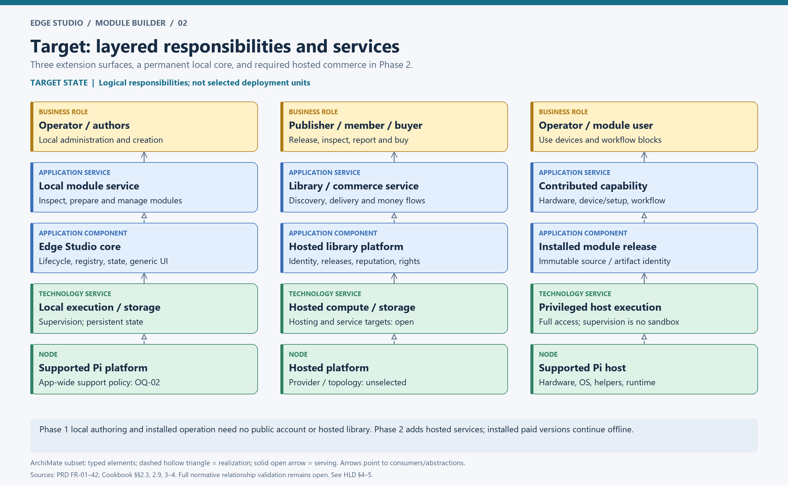
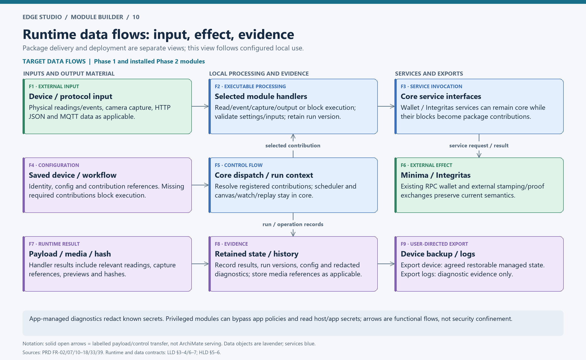
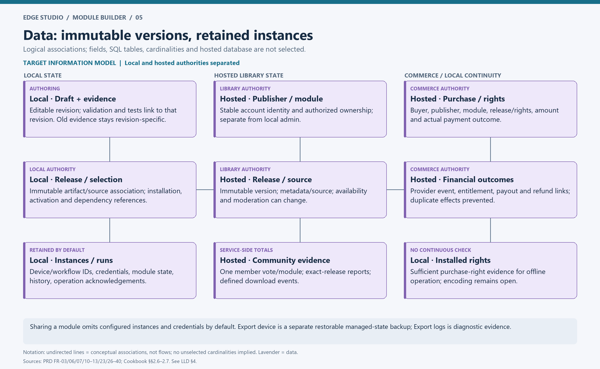
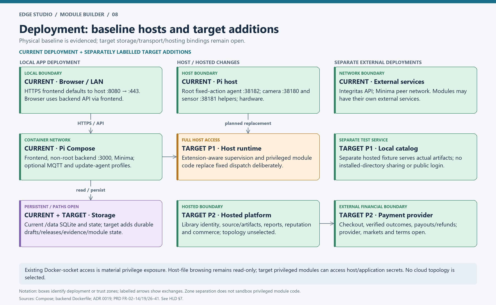
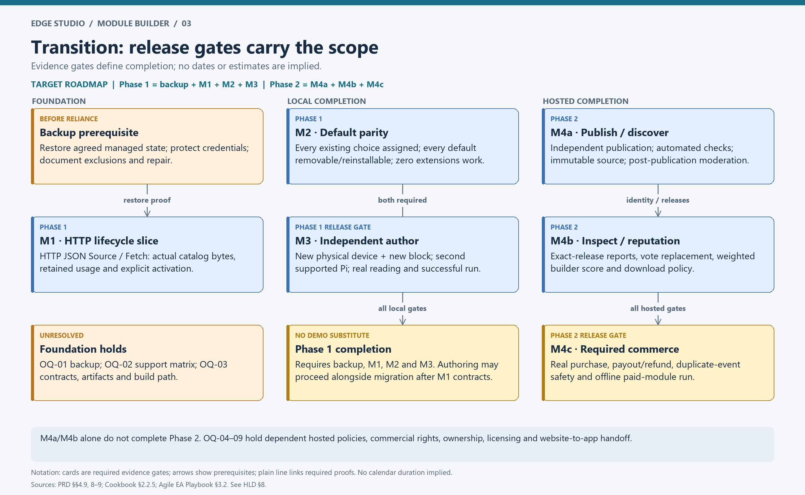

# Module Builder — High-Level Design

**Version:** review draft 1 · **Baseline date:** 2026-10-30 · **Authority:** [PRD](../../../tasks/prd-module-builder.md).

This is a target architecture description with a separately evidenced current state. It does not report Module Builder as implemented. Normative product behaviour comes from the PRD; named components below are logical responsibility boundaries. Their physical separation is unselected. Detailed contracts are in the [LLD](LLD.md); requirement coverage and source application are recorded in [traceability](traceability.md) and [sources](sources-and-method.md).

## 1. Vision, scope and principles

The business outcome is independent delivery of hardware capabilities, device definitions/setup and executable workflow blocks through installable modules, without core-source edits or app rebuilds. Both phases are mandatory (PRD §§1–2, FR-01–42):

| Architecture state | Included outcome | Release boundary |
| --- | --- | --- |
| Baseline | Compiled application-specific hardware/device/workflow behaviour and a frontend concept | Not a module platform |
| Target Phase 1 | Local module lifecycle, all default capabilities extracted, app-driven local authoring, real catalog fixture, restorable managed-state backup | Backup prerequisite and M1, M2, M3 all pass; independent physical-device and block proof on another supported Pi |
| Target Phase 2 | Hosted identities/releases, discovery, source inspection, reporting/moderation, reputation, checkout, payouts/refunds and offline entitlements | M4a, M4b, M4c all pass, including provider-backed commerce |

Architecture principles derived from the PRD: preserve a small permanent core; keep the browser on authenticated backend APIs; separate inspection from execution; require explicit activation; preserve configured state/history; keep installed operation independent of the library; describe full host privilege truthfully; retain immutable release identity; require reproducible evidence. App-wide support policy governs modules. Public accounts are separate from local single-admin access.

Non-goals remain those in PRD §5: no full IDE, required CLI/AI provider, cloud build farm, arbitrary initial custom frontend/editor hooks, security sandbox, strong DRM, automatic module updates/dependency upgrades, fleet rollout, automatic rollback, guaranteed reversal of privileged host effects, new module-specific support matrix or module-only replacement for app backup. Source inspectability does not select a license.

## 2. Stakeholders and business responsibilities

This catalog and concern-to-view mapping tailor TOGAF stakeholder artifacts to the supplied playbook/corrigendum; they do not appoint actual people.

| PRD role | Responsibility / concern | Architecture views and evidence |
| --- | --- | --- |
| Operator | Inspect identity, access and compatibility; backup; explicitly install/activate; recover preserved instances | Diagrams 04, 06–08; backup, M1/M2 |
| Template author | Configure existing protocol support using schemas/templates | LLD §8; M3 tooling evidence |
| Code author | Implement compatible executable behaviour with relevant programming/hardware skills | LLD §§2, 8; M3 |
| Independent author | Prove a new physical-device integration and block on a second supported Pi without core edits | Diagram 03; M3 |
| Publisher | Maintain immutable versions under stable publisher identity without routine core release/review | Diagrams 02, 09; M4a |
| Library member / buyer | Discover, inspect, rate/report, buy and obtain entitled releases | Diagram 09; M4a–c |
| Contributor | Receive traceable payout and refund outcomes | LLD §11; M4c |
| Initial moderators | Post-publication report triage and inappropriate-content handling | HLD §5; OQ-04/08 |
| Service operators | Monitoring, backup/restore, incident/report handling for hosted services | HLD §7; OQ-08 |
| Platform team | Runtime/contracts, official-package lifecycle and creation tools | HLD §8; FR-41 |

Library account roles do not introduce local multi-user administration. The suggested product/security/finance/legal decision roles in PRD §9 are decision participants, not confirmed owners. Actual service, moderation and official-package owners must be named before hosted launch.

## 3. Current state — repository evidence

The PRD §1 baseline is corroborated by the repository snapshot:

| Area | Current evidence | Consequence |
| --- | --- | --- |
| Browser/API | React UI, Express/TypeScript backend; Compose frontend HTTPS mapping defaults to host 8080 → container 443; backend 3000 internal | Backend owns shared business logic |
| Hardware | [ADR 0019](../../adr/0019-hardware-access-through-host-helpers.md), `backend/src/features/host-capabilities/hostCapabilities.routes.ts`, `host-agent/edge_studio_host_agent.py` | Fixed Camera/GPIO/I2C/Local MQTT actions; token-protected host services, no arbitrary module dispatcher |
| Devices/setup | `frontend/src/features/data-sources/DataSourceTemplates.tsx`, `dataSourceTypes.ts`, `deviceSetupGuides.tsx`; backend data-source service | Compiled definitions and per-type behaviour |
| Workflows | `backend/src/features/automation/automation.service.ts` contains named block dispatch; frontend workflow feature owns canvas/watch | Execution branches require application changes |
| Persistence | Compose binds `/data`; `DATABASE_PATH=/data/edge-studio.db` | Existing SQLite, configuration and history are migration inputs |
| Integrations | Minima container/RPC; external Integritas; camera/sensor host helpers; optional Mosquitto; update-agent profile | Existing services continue; their block contributions can move to packages |
| Module concept | `frontend/src/features/module-builder-demo/`, SECURITY.md demo scope | Browser simulation; no proof of real installer, privileged runtime, hosted publishing or payments |
| Backup | Existing Minima backup feature; docs task explicitly calls for app-wide device export/restore work | Minima backup, history export and demo downloads do not establish FR-10 |

This baseline is a document/code review, not a live Pi deployment audit. Default module inventory is incomplete; the named hardware families are examples explicitly required by FR-16, not a claim that every current choice has been inventoried.

## 4. Target Phase 1 — local architecture

| ID / logical building block | Responsibility | Permanent core or package |
| --- | --- | --- |
| C1 Administration and generic UI | Authentication, My Modules/workspace journey, schema forms/wizards, canvas, unavailable placeholders, diagnostics and recovery access | Core |
| C2 Lifecycle and artifact management | Inert intake/inspection, compatibility/integrity checks, install/update/disable/remove actions, immutable releases, operation records and startup reconciliation | Core |
| C3 Contribution registry and dispatch | Resolve installed/active hardware, device and workflow contributions, dependencies and run-specific versions; provide generic descriptors | Core |
| C4 Host supervision | Versioned runtime invocation, privileged setup/test/runtime lifecycle, health, cancellation and operation observations | Core host infrastructure; replaces fixed dispatch during implementation |
| C5 State, history and recovery | Existing device/workflow IDs/configuration, run history, persistent module state, app-wide export/logs/restore, repair access | Core |
| C6 Authoring and preparation | Templates, source/metadata/schema editing, inert previews, revision-scoped validation/tests, app-driven packaging/import/export; module-builder-skill for external harnesses | Core creation tools; templates/examples may accompany packages |
| P1 Installed module releases | Hardware capability definitions and code; device roles/schemas/setup/guides/tests/starters; block metadata/handlers/cancellation/help | Removable packages, including defaults |
| X1 Local catalog fixture | Separately hosted downloadable versioned default artifacts; normal installer receives actual bytes | Phase 1 test service, outside installed-module storage |

C1–C6 are Architecture Building Blocks describing responsibility, not six new services. Current React/Express/SQLite/Compose and host helper implementations are concrete baseline choices. Target executable languages, package/source formats, dependency resolution and host communication bindings remain unselected (OQ-02/03). No microservice or hosted database choice is implied.

Retained Wallet/Integritas services may remain core; their workflow blocks must follow the package route. A zero-extension app still authenticates, displays retained devices/workflows/history as unavailable, manages modules and exposes recovery. Removed defaults stay removed across restarts/updates.

## 5. Target Phase 2 — hosted responsibilities and integration

Hosted logical responsibilities extend the Phase 1 package path: stable member/publisher identity and ownership authorization; immutable release/artifact/source delivery; automated publication checks; search/listing/profiles; release-specific source inspection/reports; post-publication moderation; service-side ratings/aggregates/download totals; commerce and entitlement records.

| Interface / direction | Information and control boundary | Connectivity and authority |
| --- | --- | --- |
| Browser → local backend | Inspect, prepare, backup/export, acknowledge execution, install/activate, device/workflow use and operation status | Local authenticated administration for changes; no browser-to-root execution |
| Backend → catalog/artifact provider | Catalog metadata and actual release bytes; integrity/compatibility validation before execution | Phase 1 separate fixture or Phase 2 official delivery; offline seed uses same installer |
| Backend ↔ host supervision ↔ module code | Versioned request/result/event, operation identity, deadlines, cancellation, hardware effects | Authenticated service boundary; effective host privilege is deliberately broad |
| Module ↔ device/helper / core service | Read/event/capture/output, MQTT/HTTP, Integritas stamping, Minima wallet interactions where applicable | Preserve existing credential/data behaviour; module-specific external services remain declared dependencies |
| Publisher → hosted release service | Prepared artifact, matching source, identity/version, compatibility/access and change notes | Authorized publisher; automated basic checks before availability, useful errors |
| Member → hosted services | Discovery, exact-version inspection/report, rating replacement, checkout | Public listing versus identified user changes; paid source-access policy OQ-06 |
| Hosted commerce ↔ payment provider | Checkout and verified outcomes, payout/refund requests/results, reconciliation | Provider and transport/auth details unresolved; duplicate events have one business effect |
| Hosted delivery → local package path | Official entitlement-authorized download followed by local inspection/install/activation | Purchase/download/website visit never activates device code |
| Public website → app | Selected release handoff | Mechanism and account flow OQ-09; explicit authenticated device action retained |

Library outages prevent new online actions and produce truthful errors. Installed free and paid releases continue normal operation without library/license heartbeats; a module's own external dependency is disclosed separately. Withdrawn releases stop new official downloads; retrieval/update/post-refund rights await OQ-06. Moderation/ratings do not certify privileged code. Initial humans moderate after publication; routine human pre-approval is excluded. Community-managed moderation is an intended later operating model with unselected transition criteria.

## 6. Data architecture and flows

Local information comprises drafts and revision-scoped evidence; immutable release artifacts/source associations; selected installed versions and dependency references; active contributions; independently enabled hardware; configured devices/workflow references; run-specific resolution and historical presentation; module-owned state; durable acknowledged operation results; credentials and backup/log exports. Hosted information comprises stable ownership, immutable versions, availability/moderation findings, inspection reports, one member vote per module, successful-download events, and traceable purchase/entitlement/payout/refund outcomes.

The local app remains authoritative for local configuration, activation and execution. Hosted services are authoritative for library identity, official availability, reputation calculation and purchase/delivery rights. Provider-confirmed outcomes govern payment reconciliation; neither the browser nor a timed-out request proves payment success. Local retained purchase-right evidence must enable offline continuity; its encoding is unresolved.

Download/import/source viewing/non-executable preview are inert. Acknowledged executable setup/test/runtime may reach host files, OS services, hardware and application secrets. Log redaction applies to app-managed output; it cannot guarantee secrecy against privileged code. Sharing packages omits configured instances and credentials by default. Export device covers the separately agreed managed state; Export logs is diagnostic; neither package export nor swapping code restores managed state.

## 7. Deployment, security and operations

Current deployment is a Pi with Compose frontend/backend/Minima, optional MQTT and update-agent, persistent data volumes and host-side Python helpers/root agent. Backend runs as `node` in its Dockerfile; Compose also mounts the Docker socket, which is an existing material privilege exposure. Host-file browsing is a separate read-only mount. Token-protected helpers default to ports 38180/38181 and root agent to 38182; these are baseline values, not new module-runtime port decisions. Minima RPC is internal and host-loopback bound by default. Update-agent manages app releases; manual module lifecycle remains separate.

Target additions are persistent package/draft/evidence/state storage, registry/lifecycle responsibilities and extension-aware host supervision. Host process/service arrangement, protocol/ports, filesystem layout and runtime bindings need engineering specification. Phase 1's catalog is separate from installed files and needs no public account. Phase 2 hosting location, regions, database, object storage, identity provider, scale and redundancy are unspecified; the diagrams show logical zones only.

The authenticated admin boundary controls consent and local mutations. The host-supervisor boundary controls dispatch but cannot confine privileged module behaviour. Known app-managed secrets must be redacted in displayed/shared diagnostics. Modules can bypass app restrictions; no safety, integrity or secrecy guarantee against malicious root code is claimed. Recovery requires an operable host/app and does not reverse arbitrary OS/firmware/hardware changes.

Required operational signals include durable install/update progress/outcomes, incomplete host effects, reboot needs, module health/unavailability, startup reconciliation, publication/check failures, report status, payment uncertainty/deduplication, and online delivery failures. Exact alert thresholds, retention/quota limits, service levels, backup schedules, RPO/RTO and incident ownership are gaps G-02/G-03/OQ-08. No new telemetry service is required by the PRD. Hosted backup/restore and incident/report procedures need named owners before launch.

## 8. Transition architecture and governance

| Work package / transition | Required proof | Dependencies / review hold |
| --- | --- | --- |
| Backup prerequisite (#1083) | Restore all agreed managed-state coverage; distinguish logs and package exports; document credential handling/exclusions/repair | OQ-01; supported restoration targets |
| M1 lifecycle slice (#1084/#1085) | HTTP JSON Source/Fetch: retain existing config/history through disable/remove, actual catalog download, install, explicit activate, restart | Contracts and compatibility/build route OQ-02/03; backup prerequisite before reliance |
| M2 parity (#1086–#1089) | Every hardware/device/setup/block choice assigned an owner; every default remove/download/reinstall cycle; zero-extension operation and default-set restoration on supported Pi | Signed-off inventory; no permanent built-in execution fallback |
| M3 authoring proof (#1090/#1091) | External author creates new physical device + block in app journey; another supported Pi gets a real reading/event and successful block run | Contracts, tooling and physical evidence; M2 and backup also required for Phase 1 release |
| M4a publication (#1092–#1095) | Independent publish, automated rejection/correction, discovery, exact-source identity and post-publication report/moderation | OQ-03/04/08/09; immutable release identity |
| M4b reputation (#1095/#1096) | Vote replacement, unrated states, weighted builder scores and correct defined download totals | OQ-05; stable identities |
| M4c commerce (#1097/#1098) | Paid release inspection under agreed policy, actual purchase/delivery/activation, payout/refund paths, duplicate-event safety and offline paid execution | OQ-06/07; all Phase 2 gates and operational ownership |

Authoring can proceed alongside extraction after the first contracts/lifecycle slice. M4a/b can precede commerce but cannot complete Phase 2. No effort estimate or date commitment is added. Temporary extraction adapters need an owner and removal criterion; M2 cannot retain an execution fallback for uninstalled modules. Legacy device/block identifiers and secrets/history must be migrated without recreation.

This pack tailors ADM responsibilities: A (vision/stakeholders), B (roles/journeys), C (application/data), D (deployment), E/F (transitions/dependencies), G (acceptance evidence), H and Requirements Management (versioned changes and impact assessment). It is not a claim that an enterprise ADM cycle has been completed. Product policy changes update the PRD and tickets together; implementation security changes also amend ADR 0019, SECURITY.md, project constraints and mirrored contributor rules. This documentation exercise adopts no new implementation ADR.

## 9. Review disposition

All 42 requirements have architecture responsibilities and evidence obligations in the traceability matrix. Approval for dependent implementation remains blocked by the applicable [decision gates](decisions-and-gaps.md). Full formal standards validation is limited by missing full standards. No physical runtime, restoration, hosted-service or financial acceptance evidence was produced by drawing this architecture.
