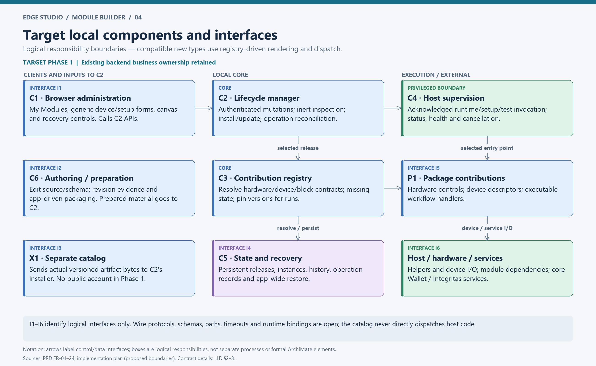
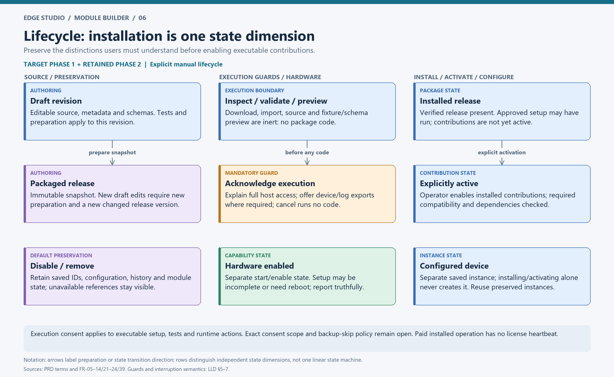
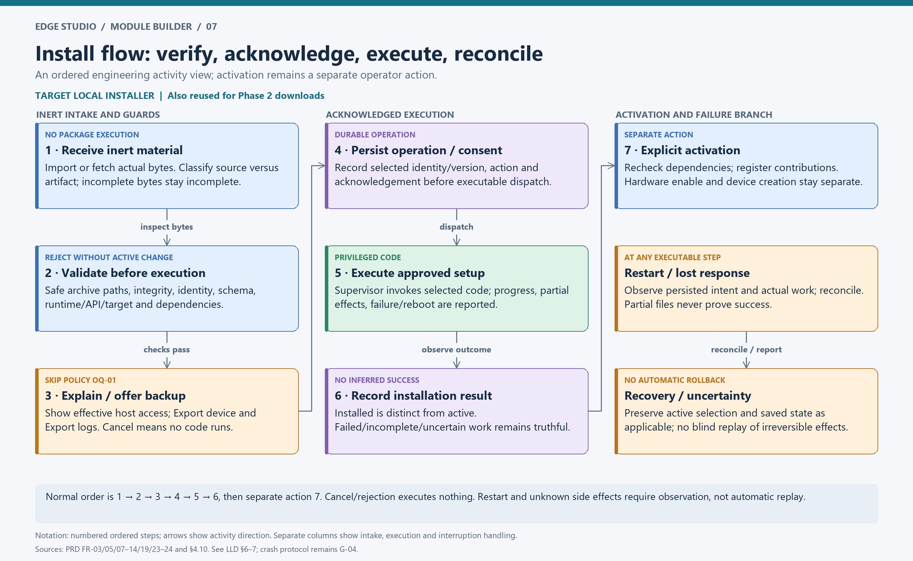
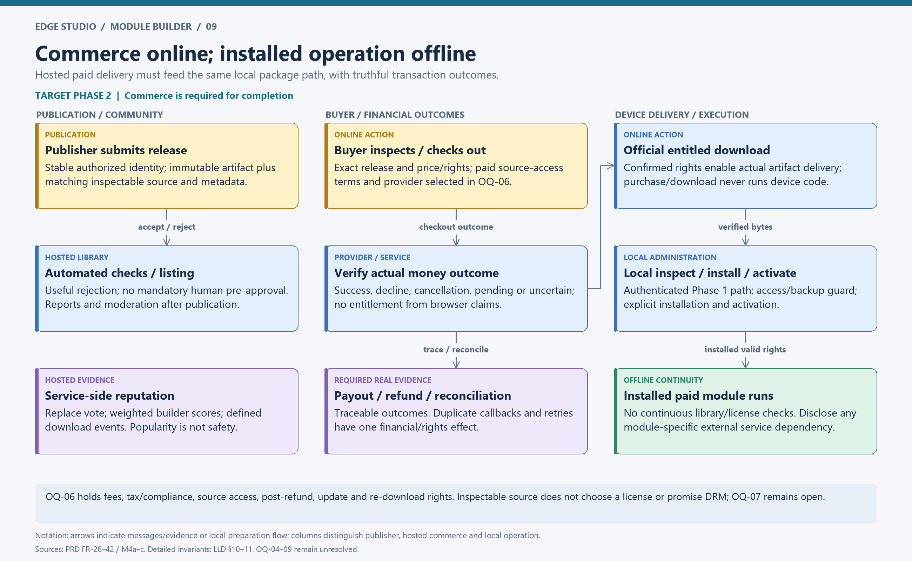

# Module Builder — Low-Level Design

**Status:** review draft 1, 2026-10-30. **Authority:** [PRD](../../../tasks/prd-module-builder.md). See [HLD](HLD.md), [traceability](traceability.md) and [open decisions](decisions-and-gaps.md).

## 1. Design status and implementation boundary

This LLD specifies logical inputs, outputs, guards, persistence invariants and failure semantics derivable from the PRD. It is not a completed OpenAPI, database migration or executable module ABI. The PRD explicitly leaves formats, languages, tables, vendor and entitlement encoding unselected. Inventing those choices would conceal its decision gates.

**Required** below means a PRD obligation. **Logical design** names responsibilities and information needed to meet it, without asserting a deployed component or final field spelling. **Open** identifies a policy/binding to select before implementation. Fields in tables are information concepts, not JSON keys or SQL columns. No proposed route or pseudocode is a currently supported API.

## 2. Local responsibility boundaries

| Boundary | Logical input → output | Invariant |
| --- | --- | --- |
| C1 → C2 authenticated administration | Administrator action + chosen module/release + applicable acknowledgement → operation identity/status or actionable rejection | UI does not execute code directly; no local multi-user scheme added |
| C6 → C2 preparation/intake | Draft revision/source or packaged artifact → format classification, validation evidence, immutable prepared release | Source is not automatically install-ready; edits never mutate packaged bytes |
| C2 → C3 registry | Verified installed release + explicit activation intent → resolved contribution set or conflict/missing-dependency result | Installed is distinct from active; validation precedes execution |
| C2/C3 → C4 runtime | Selected release/entry point + operation/run context → progress, result, event or uncertain/incomplete state | No execution before relevant consent; supervision is not sandboxing |
| C3 ↔ C5 configuration/history | Saved contribution reference + compatible selected version → available instance or preserved unavailable view | No loss of IDs/configuration/history on disable/remove |
| C4 ↔ packages/helpers/core services | Typed action/read/event/capture/output and runtime lifecycle → result/health/diagnostics | New compatible types require no hard-coded per-type branch |
| C2/C5 recovery | Declared managed state + export/restore intent → backup/log artifact or restore outcome | Restore operates through app-wide path; coverage/credentials OQ-01 |

Frontend/schema work stays in existing device/workflow layouts and design system. Loading, empty and failed-load states are required on lists/details. Descriptors render through generic controls; no arbitrary package frontend pages or custom block editor hooks are implied. Implementation feature paths suggested by the existing plan are proposals, not present modules.

## 3. Contract catalogs

### 3.1 Manifest and prepared release (FR-03/06/23/24/27)

| Required information | Validation / use | Open binding |
| --- | --- | --- |
| Namespaced module identifier, version | Identify exact module/release; reject malformed identity and conflicting immutable contents | Namespace/version syntax and version-order rules OQ-03 |
| Author/publisher identity | Preserve provenance; stable authorized hosted ownership in Phase 2 | Local-to-hosted identity mapping and transfer policy G-05/OQ-05 |
| Contribution definitions | Validate hardware/device/block descriptors, schemas and references before registration | Schema dialect, limits and ABI versioning G-01/OQ-03 |
| Runtime entry points and execution privileges | Match supported contracts; disclose effective host access before executable actions | Runtime languages, launch bindings and targets OQ-02/03 |
| Dependencies and required app/module-API versions | Check availability/compatibility; retain selected versions for runs; prevent unsafe shared-dependency removal | Ranges, graph/cycle rules, resolution and migration policy OQ-03/G-01 |
| Target compatibility | Compare module subset with app support policy | Actual Pi/OS/architecture/runtime/app values OQ-02 |
| Documentation | Explain purpose, setup, operation, limitations and external services | Required documentation schema/limits G-01 |
| Artifact integrity + source association | Validate exact artifact; published source matches exact immutable release | Formats, build path, digest/signature/trust mechanism OQ-03; no assumed signature requirement |
| Hosted description, change notes, license information, price/free status | Populate exact-version listing and purchase inspection | License policy OQ-07; commercial/source access OQ-06 |

Reject malformed archives, unsafe paths and integrity mismatches without running package code or changing the active release. Archive extraction must remain inside its staging destination; traversal, absolute paths and link-based escapes need explicit format-specific rules before code is written (G-01). Package parsing and schema rendering must not invoke imported scripts, hooks or executable templates. Artifact size, archive expansion and resource limits require selection; existing generic upload limits do not define the module format.

### 3.2 Contribution contracts (FR-16–18)

| Surface | Required descriptor | Required behaviour |
| --- | --- | --- |
| Hardware | Identity, setup/configuration, status, operations/events and docs | Setup, start/enable, stop/disable, repair and uninstall; repeated attempts, shared dependencies, partial failure and reboot reporting; Camera/GPIO/I2C Sensors/Local MQTT helper parity |
| Device/setup | Identity, role, fields/defaults/validation, steps/guides, relevant tests and optional starter workflows | Read, event, capture and output as applicable; preserve preview/hash and credential behaviour; no compiled frontend type branch for compatible new definition |
| Workflow block | Identity, execution role/category, settings and input/output definitions, validation, handler, cancellation, summaries/help | Generic execution dispatch; retain core canvas/scheduler/history/watch/replay; no irreversible side-effect retry on unknown result |

Contribution references must distinguish module identity from contribution identity and resolve saved legacy references. Exact alias encoding and mapping belong to migration design. A package may contribute one or all surfaces. Not all device roles apply to every package; descriptors identify the supported roles.

### 3.3 Runtime and administration contracts

The existing implementation plan proposes versioned request/result/event envelopes with operation IDs, errors, deadlines, health and shutdown. This LLD retains that as a **logical design**, without selecting HTTP, sockets, subprocess stdio, language or ports.

| Logical envelope | Minimum information / semantics |
| --- | --- |
| Request | Contract version; correlation/operation or run identity; exact selected release/contribution; action/entry point; validated inputs; deadline/cancellation context; reference to recorded consent where executable |
| Progress/event | Operation/run identity; originating release/contribution; observed phase/status/event; diagnostic detail safe for app display; time/order sufficient to reconcile |
| Result/error | Identity; truthful completed/failed/incomplete/reboot/uncertain outcome as applicable; known effects; actionable reason; redacted diagnostics; no invented success on timeout |
| Supervision | Health/start/stop/cancel observations; clear distinction between cancellation request and confirmed termination; in-flight selected version retained |

Exact message serialization, delivery ordering, reconnect semantics, error codes, timeout values, duplicate-action handling and supervisor authentication are G-01/G-04. These must be specified and tested before M1 runtime sign-off; no unknown irreversible action is replayed just to obtain a response.

The local API must expose logical operations for list/detail/inspect, inert intake/download/validate/preview, install/update, activate/disable/remove/reinstall, draft editing/preparation/tests, operation status/logs, package export and app-wide device/log export/restore. Route names, verbs, DTOs and response codes are unselected. All module-changing operations require the existing authenticated administrator boundary; public website/library identity is not device authorization.

## 4. Persistent information model

These are logical entities/associations, not a chosen SQL schema. Existing local SQLite remains a baseline fact; target file layout and hosted persistence technology remain open.

| Logical object | Required identity / relationship | Persistence and preservation rule |
| --- | --- | --- |
| Draft | Module intent + revision; editable source/metadata/schemas/fixtures | Survives restart/update; new revision invalidates applicability of old preparation/test results |
| Validation/test evidence | Draft revision or exact release + check/test + result | Never describe stale evidence as validating changed code; fixtures do not prove physical compatibility |
| Release | Module + immutable version; artifact identity; matching source/material; contract/target/dependency metadata | Draft edits cannot mutate release bytes; changed release uses new version |
| Installation/selection | Local release presence + chosen dependency/version references | Distinct from activation; interrupted installation cannot appear complete from files alone |
| Activation / contribution | Selected release + registered contributions | Explicit operator action; missing/incompatible dependencies prevent ready state |
| Hardware state | Capability instance + enable/status/setup operation | Independent of installation/activation; report partial/reboot state |
| Configured device | Existing device ID + contribution reference + config + credential references | No creation as side effect of install; preserved by default on disable/uninstall |
| Workflow definition | Existing workflow/block IDs + settings + contribution/device references | Missing required contribution prevents execution but retains visible saved definition |
| Execution record | Run/block identity + selected release/dependency versions + outcomes/history | In-flight version fixed; historic runs inspectable after package removal |
| Module-owned state | Module/version/schema association sufficient for diagnosis and migration | Retained on disable/remove by default; migration and compatibility policy unresolved |
| Operation record | Module/version, action, acknowledgement, progress/outcome, known host effects and diagnostics | Durable across restart/update; reconcile partial work; redact known managed secrets |
| Backup / logs | App-wide coverage/version context and protected credentials versus diagnostic records | Distinct export types; restore coverage/retention/encryption policy OQ-01 |
| Hosted account/publisher/module | Stable identity + authorized ownership | Display-name changes cannot change ownership/aggregate attribution |
| Hosted release / inspection / report | Exact version, matching artifact/source, author claims, automated findings, community report and moderation status | Separate evidence classes; published contents immutable, availability can change |
| Rating / download event | One identified member vote per module; defined successful-download event | Replace vote in place; service computes aggregates; download event policy OQ-05 |
| Purchase / entitlement | Buyer, publisher, module, purchased release/rights, amount and payment outcome | Confirmed rights authorize official delivery; retain local offline rights evidence in an unselected format |
| Provider event / payout / refund | Stable external transaction/event association and traceable business outcome | Duplicate callbacks/retries cannot duplicate charges, rights, payouts or refunds |

One module can have many releases, a draft revision can have multiple evidence records, and saved instances/runs reference particular contributions/releases. Exact multiplicities for simultaneous installed/active versions, publisher transfers, state migrations and entitlements are not specified by the PRD (G-05). Diagram associations deliberately omit those cardinalities.

Package export excludes configured instances/application credentials by default. Default uninstall preserves configuration/history/module state and identifiers; data deletion is a separate explicit action. Active release changes must retain artifacts/version references needed for in-flight runs. Artifact garbage collection and history/diagnostic retention need defined rules (G-02); no automatic pruning policy is invented here.

## 5. Lifecycle state dimensions

The lifecycle is not one linear status. Distinguish independently:

1. **Draft/preparation:** editable revision; validated/tested evidence applies only to its revision; packaging creates a fixed release. Subsequent edits require preparation again.
2. **Artifact presence:** absent, intake/download incomplete, or verified locally present. Incomplete bytes cannot appear install-ready.
3. **Installation:** install/update operation not yet completed versus release installed. Approved executable setup can happen here, without activating contributions.
4. **Activation:** installed release inactive or explicitly active; disabling removes availability, not saved instances/history.
5. **Hardware:** capability-specific enabled/stopped/incomplete/reboot state; activation alone does not imply hardware is enabled.
6. **Configured device/workflow:** saved instance separate from package presence; resolve availability from required contributions and retain unavailable references.
7. **Operation:** progress and truthful terminal/uncertain/interrupted outcome; not inferred from artifact presence or browser request completion.

The labels above describe semantic states rather than a final persisted enum. OQ-03/G-01/G-05 must settle exact transition guards, dependency/version selection, concurrent actions and state migration. Neither library purchase, download nor source viewing crosses the execution boundary. Installed paid operation does not require license-server contact.

## 6. Install, activate, update and remove flows

### 6.1 Inspect / intake

Operator selects a local import, separate local catalog artifact, hosted version or bundled offline default. Backend retrieves/classifies metadata/source/artifact and validates inert structure, safe archive paths, identity, integrity, supported target/API/runtime and available dependencies. UI shows exact identity/version/provenance, source route, effective access and actionable incompatibilities. No package code runs. Interrupted downloads remain incomplete and offer user-directed retry.

### 6.2 Execution acknowledgement and installation

Before executable install/update hooks or privileged local draft testing/activation, show the host-access warning and offer app-wide Export device and Export logs. Explain credential coverage and exclusions under OQ-01. Cancellation must stop before package code. The prompt is mandatory; permission to continue without an export is unselected. For any other action running setup/test/runtime code, obtain appropriate administrator acknowledgement (FR-05).

Record consent, selected module/release, action and operation identity before dispatching executable work; the exact durable transaction protocol is G-04. Supervision runs the selected entry point under the agreed runtime contract and reports progress, result, partial host changes and reboot needs. Completed installation records release presence and setup outcome; it does not activate contributions. UI must not equate missing response, partial files or restart with success.

### 6.3 Explicit activation / normal use

An administrator explicitly activates a compatible installed release. Recheck dependency/compatibility against current selection. Publish contributions through the generic registry only when requirements are satisfied. Hardware enablement and configured-device creation remain separate actions. Existing preserved compatible instances resolve without manual recreation. Runtime code needs the applicable acknowledged execution boundary; exact acknowledgement scope/lifetime remains G-01.

At workflow start, resolve required contributions and retain selected versions for the in-flight run. Missing required contributions block execution and produce an actionable unavailable state. Dispatch through registered handlers using validated settings/inputs and record results with module/version context. Scheduler, history, watch/replay and canvas remain core. Preserve read/event/capture/output/preview/hash/credential semantics through extraction.

### 6.4 Manual update

Operator chooses a new version; compatibility/dependencies and source/access are inspected before execution. Prepare the new release before switching active contributions. Apply the required backup/consent boundary for executable hooks. Keep the run-selected version available to in-flight work. Do not silently upgrade dependencies or activate incompatible code. Module-state schema changes, migration ordering, failed migration handling and active-selection commit/reconciliation must be specified before implementation (G-01/G-04); code replacement alone is not state restore. No automatic rollback is promised.

### 6.5 Disable / uninstall / reinstall

Disable removes contribution availability while retaining saved configuration/history/state. Uninstall removes the package's installed capability according to the selected version/dependency policy; check shared dependencies and report remaining host effects. Any executable uninstall hook is itself subject to execution acknowledgement. Uninstall does not automatically delete retained data or reverse arbitrary host changes. Stop/cancel versus in-flight-run handling requires the explicit concurrency policy in G-04.

Show preserved device/workflow identity/configuration, unavailable reason and reinstall/activation route. Reinstall by the normal installer from actual artifact bytes, then explicitly activate; restore original compatible usage without recreation. Restart/update must not silently seed defaults removed by the operator. Explicit restoration of the default set is demonstrated in M2 through the package path.

## 7. Failure, interruption and recovery semantics

| Trigger | Required local/hosted behaviour | Evidence |
| --- | --- | --- |
| Malformed package, unsafe path, digest mismatch | Reject before code; active release unchanged; explain reason | Negative archive/integrity test |
| Unsupported target/runtime/API or missing dependency | Explain unsupported/missing requirement; do not mark ready | Compatibility/dependency cases tied to approved support matrix |
| Consent/backup cancellation | No setup/test/runtime execution | Instrumented no-entry-point invocation assertion |
| Download interruption | Incomplete artifact unavailable to install; user-directed retry | Truncated download/restart test |
| Hook failure/timeout/reboot | Report failed/incomplete/reboot state and known partial effects | Controlled hook cases + supported hardware |
| App/Pi restarts during install/update | Reconcile durable operation with observed worker/files/active selection; show uncertainty when unresolved; never infer success from files | Fault injection before/after each durable/executable boundary |
| Crash/disable/remove | Preserve instances/history and show unavailable state; keep module/recovery controls while host/app operable | M1/M2 and crash test |
| Irreversible workflow action times out | Record uncertain effect; do not automatically repeat | Side-effect counter plus lost-result/cancellation scenario |
| Draft edited after preparation | Old package/evidence remains linked to old revision; require new validation/package preparation | Edit/package regression |
| Duplicate rating/payment event | Replace existing vote or apply financial business effect once | Concurrent duplicates and callback/retry cases |
| Library/provider outage | Truthful unavailable online action / known transaction state; installed local capability continues | Network isolation, including paid offline test |

Logical recovery design: persist intended operation and selected versions, observe progress/outcome, and reconcile interrupted actions at startup independently of normal extension startup. This is not authorization to replay a hook with unknown effects. Exact journal format, crash-consistency protocol, worker observation/reconnect rules, locks, cancellation guarantees and retry policy remain G-04. Recovery controls cannot survive every malicious privileged host modification.

App-wide restore must reproduce all agreed managed device/workflow config, module versions/artifacts/state, history and credentials within declared coverage. Document exclusions, protected export handling, supported restore targets and user-directed repair/reinstall. Prove it after a supported change before relying on the backup prompt. Export logs is diagnostic; package export is sharing; neither substitutes for restoration.

## 8. Local authoring and evidence

My Modules provides template creation, metadata/source/schema editing, forms/wizards/block preview with fixtures, validation, explicitly labelled executable tests, logs, packaging, source/package import/export and explicit activation. Template authors reuse protocol support; code authors implement new behaviour. Local work needs neither public account nor hosted service.

The module-builder-skill supplies versioned contracts, expected file structure, examples/templates and app-driven test/package guidance to the user's own AI harness. Manual coding is equally supported; no built-in generation harness, automatic provider connection or required module CLI is introduced.

Each validation/test result identifies the draft revision or release tested. Inert previews render schemas/fixtures; previews running code must say so and use consent/backup guards. Shareable exports include material needed for the declared format and omit configured instances/credentials by default. Source import identifies missing build/runtime/dependencies and cannot masquerade as an install-ready artifact. OQ-03 blocks final format/build-path specification.

M3 needs a previously unsupported physical device and new block authored outside the core team, packaged/exported through the supported journey, installed/activated on another supported Pi, with a real event/reading and successful workflow. Template-only, HTTP-only, demo screenshots and fixture success do not satisfy it.

## 9. Migration and default parity

Inventory every hardware choice, device/profile/setup guide, block, role, schema, event listener and current observable behaviour. Record existing identifier, owner/package assignment, credential/state mapping, migration action, parity scenario and evidence. The architecture pack is not that completed inventory.

Migrate identifiers, saved config, secrets and histories without recreating devices/workflows. Generic UI must retain historical display information needed after removal. Resolve legacy aliases explicitly, avoid duplicate listeners, and remove temporary execution adapters by M2. Start with HTTP JSON Source/Fetch; then cover Camera/GPIO/I2C Sensors/Local MQTT and all other existing extension choices. Every default package must pass original behaviour → disable/remove → unavailable → real catalog bytes → install → explicit activate → original usage, plus restart and zero-extension checks. Default ownership must be recorded; official-package maintainers must be named under OQ-08.

## 10. Hosted publication, discovery and reputation

Publisher authorization checks stable identity/ownership on version submission. Automated basic acceptance checks run before availability; failures are actionable and resubmittable. Accepted release contents/source cannot be overwritten under the same version. Policy limits/blocking checks are OQ-04; no routine mandatory human/core-team approval or required AI checker is added.

Listings/search/details/profiles expose purpose, publisher, exact release, compatibility/dependencies, effective host access, inspectable source route, license information, price/free status, rating/count and module-level downloads. Top-rated/most-downloaded sorting is required; tie ordering and pagination are G-06. Browser-provided aggregates are not authoritative. Source claims, automated findings, member inspection reports and moderation findings remain distinguishable and release-linked.

Initial human moderation handles post-publication spam/inappropriate uploads through reporting, triage and visible withdrawal/removal outcomes. Community-managed review/moderation requires agreed transition criteria. Withdrawal prevents new official downloads; already-installed operation does not require the service. Existing-purchaser retrieval rights remain OQ-06.

Reputation rules:

- One identified member has one 1–5 star rating per module. Replacement changes its value without adding a vote; enforce uniqueness and calculate on the service.
- Module mean = sum of its valid rating values / count. Zero votes displays **unrated**, not zero stars.
- Builder mean = sum of individual valid ratings across owned published modules / total count, linked by stable publisher identity. No separate builder vote. A 5 from one voter plus nine ratings averaging 4 gives 4.1 across ten votes.
- Module download totals aggregate service-observed successful-download events across releases, including a currently installed module's display. Purchases and active installations are different measures.
- Eligibility, abuse, retries, repeated users/devices, test traffic, withdrawn modules and ownership-transfer effects must be decided in OQ-05 before reputation launch. No event-counting algorithm is presumed here.

## 11. Commerce, entitlement and offline continuity

Logical flow: buyer inspects the exact release under agreed source-access terms → selected provider checkout → service records actual payment outcome → confirmed purchase enables entitled official delivery → actual bytes enter the Phase 1 installer → local administrator inspects/acknowledges/installs/explicitly activates → installed module operates without continuous library/license checks. A website visit, checkout return URL or successful download never executes device code.

Purchase information includes buyer, module, publisher, purchased release/rights, amount and outcome. Declined/cancelled/pending/uncertain payments stay truthful; an unverified browser success message cannot grant confirmed rights. The service must verify provider outcomes and reconcile uncertain transactions; exact provider authentication, event identity, idempotency scope and durable transaction/entitlement update protocol must be specified after OQ-06 selection (G-04). Duplicate callbacks/retries across charge, entitlement, payout and refund paths have one business effect. This is an invariant, not a claim that the provider has exactly-once transport.

Payout and refund records link to traceable transactions/outcomes with appropriate operator/publisher/buyer visibility. Verify successful, failed and pending provider cases, plus a payout and refund path. Fees, settlement, disputes, supported markets/currencies, tax/compliance responsibility and detailed visibility/terms are unselected. Do not invent a payment vendor, currency, tax engine or final entitlement schema.

Installed paid releases with valid purchase rights continue operating offline. Purchase and new official downloads need connectivity. The architecture requires sufficient local purchase-right evidence for this behaviour but does not choose a signed receipt, license server, key scheme or DRM. Post-refund rights, future updates and re-downloads are OQ-06; continuous checking is not an acceptable substitute. Declare separately any network service required by module functionality. Paid source/provenance stays inspectable; paid-source inspection before purchase and license/fork/redistribution rights remain OQ-06/07.

## 12. Security and operational specification obligations

Use existing local authenticated administration for local mutations; hosted publishers can only publish under authorized identities. Define service-to-service and provider callback authentication before deployment (G-01/OQ-06). Keep the backend non-root and browser on APIs, while acknowledging existing Docker-socket privilege and target module full host access. An extension-aware supervisor dispatches packages, not an unrestricted public command string endpoint. That dispatch distinction provides an execution/consent boundary, not confinement of package code.

Describe effective privileged access before setup/test/runtime code. Redact known app-managed secrets in diagnostic display/sharing; secrets can still be read/exfiltrated by privileged code. Backup protection/credential migration, package/source storage limits, archive handling, descriptor sanitization, operation access and logs need explicit specifications under the recorded gates. Recovery excludes guaranteed OS/firmware/hardware reversal.

Hosted operators need named responsibility, monitoring, incident/report handling and tested backup/restore before launch. Runtime/package maintainers and community authors retain distinct responsibilities. Support and resource limits, retention, RPO/RTO, SLOs, hosted deployment/scale and alert thresholds are open. The PRD's acceptance metrics need recorded tests/workshops; they do not mandate compulsory telemetry.

## 13. Verification and readiness

The [traceability matrix](traceability.md) links every FR to HLD/LLD coverage and acceptance evidence. Tests during implementation must include the PRD §4.10 cases, real artifact downloads, restart/crash reconciliation, retained unavailable instances, exact-version/source association, concurrency/version pinning, no duplicate financial effects, weighted reputation, protected backup/restore and offline continuity. M2/M3 require supported physical Pi/device evidence; M4c needs the chosen provider. No application acceptance gate passes through this document or its PNGs.

Implementation readiness requires resolving applicable OQ-01–09 and G-01–06 into reviewed wire schemas, persistence constraints/layout, concurrency/recovery algorithms, support targets and operational policies. This pack deliberately leaves those dependent fields unfinalized rather than claiming an implementation-ready LLD.
