# Module Builder user journey and delivery estimates

Prepared 2026-10-28. Content source: prepare-presentation.py. All screenshots are from the demo; estimates are planning hypotheses.

## 01. Module Builder

From an unsupported sensor to a shareable capability

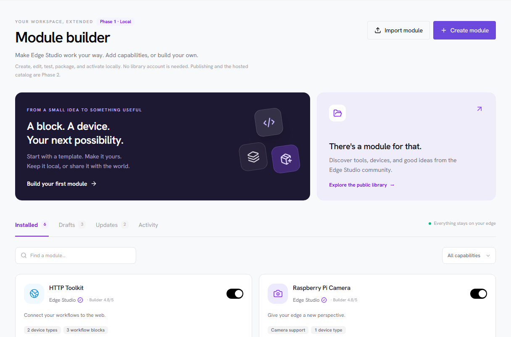

**Takeaway:** User journey, delivery phases, milestones and planning estimates · 28 October 2026

Speaker notes:

Slide 1: Module Builder

Screenshot: screenshots/01-local-workspace.png. Original demo capture; no generated UI artwork.

Stakeholder walkthrough based on the revised workshop decisions. Every UI image is a fresh capture from the frontend demo. The extension runtime, backup/restore, hosted library and commerce are not implemented. Estimates are planning hypotheses, not commitments.

## 02. One package. Two delivery phases.

The local builder delivers value before the public library exists.

- **PHASE 1 · LOCAL / Create and use:** Template → own AI harness → edit → preview/test → validate/package → back up → activate → export/import

- **PHASE 2 · HOSTED / Share and discover:** Prepare → automated checks → publish → community inspection/reputation → discover → install

**Takeaway:** No module CLI. No built-in AI generation service. Local use does not require publication.

Speaker notes:

Slide 2: One package. Two delivery phases.

AI generation is expected in the user's own harness, guided by a planned module-builder-skill. Code editing and the module tools are in the app. Automated acceptance checks run BEFORE publication; initial human spam/content moderation occurs AFTER publication. The second card is a conceptual list, not a reversal of that ordering.

## 03. 01 / Start in your local workspace

Focus: Installed modules and local drafts

- **One place to manage:** See installed capabilities, drafts, manual updates and recent activity.
- **Choose your next step:** Create from a template or import a module from another instance.
- **Local first:** Creation and local activation need no publisher account or hosted library.

**Takeaway:** A missing capability can become a local project instead of a core-team feature request.

Speaker notes:

Slide 3: 01 / Start in your local workspace

Screenshot: screenshots/01-local-workspace.png. Original demo capture; no generated UI artwork.

One place to manage: See installed capabilities, drafts, manual updates and recent activity.
Choose your next step: Create from a template or import a module from another instance.
Local first: Creation and local activation need no publisher account or hosted library.

## 04. 02 / Choose what the module contributes

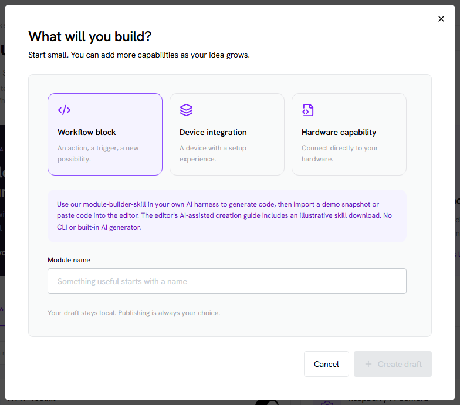

Focus: A useful starting point

- **Three contribution surfaces:** Start with a workflow block, device integration or hardware capability.
- **Reduce boilerplate:** Templates provide an example manifest, source, configuration schema and documentation.
- **Keep the contract clear:** Modules integrate through defined contracts; arbitrary code is not automatically a device.

**Takeaway:** Template authors and driver developers can use the same package model.

Speaker notes:

Slide 4: 02 / Choose what the module contributes

Screenshot: screenshots/02-template-selection.png. Original demo capture; no generated UI artwork.

Three contribution surfaces: Start with a workflow block, device integration or hardware capability.
Reduce boilerplate: Templates provide an example manifest, source, configuration schema and documentation.
Keep the contract clear: Modules integrate through defined contracts; arbitrary code is not automatically a device.

## 05. 03 / Generate in your own AI harness

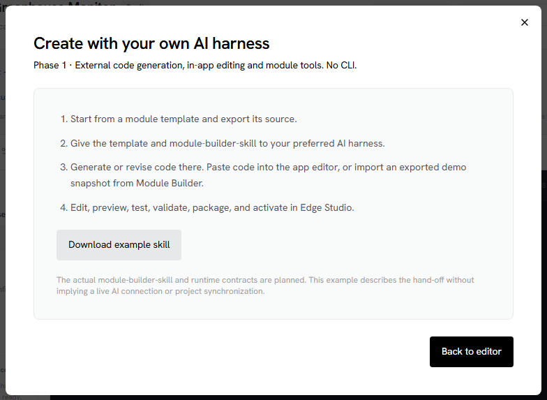

Focus: The module-builder-skill hand-off

- **Bring the contract to the AI:** Use our planned skill and template in the harness you already work with.
- **Bring code back to the app:** Paste or import generated source, then edit and check it locally.
- **A deliberate product boundary:** We provide the module journey without building an AI coding harness or CLI.

**Takeaway:** The downloadable skill in this screenshot is illustrative, not a released developer contract.

Speaker notes:

Slide 5: 03 / Generate in your own AI harness

Screenshot: screenshots/03-ai-harness-handoff.png. Original demo capture; no generated UI artwork.

Bring the contract to the AI: Use our planned skill and template in the harness you already work with.
Bring code back to the app: Paste or import generated source, then edit and check it locally.
A deliberate product boundary: We provide the module journey without building an AI coding harness or CLI.

## 06. 04 / Edit code with the outcome in view

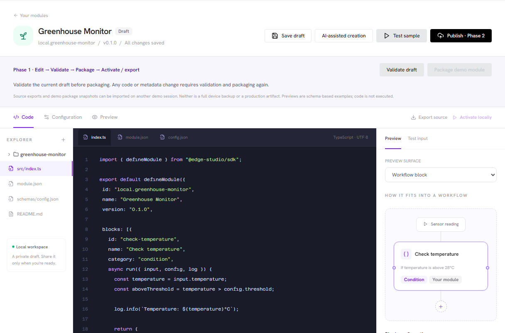

Focus: Source, configuration and preview

- **Code editing stays in the app:** Inspect files and make changes after the external generation step.
- **Configuration is a schema:** Forms, guides and wizard steps use common rendering contracts.
- **Scope stays focused:** Arbitrary custom views and block editors wait for a concrete required example.

**Takeaway:** The code editor supports module work; it is not a commitment to a full IDE.

Speaker notes:

Slide 6: 04 / Edit code with the outcome in view

Screenshot: screenshots/04-edit-and-preview.png. Original demo capture; no generated UI artwork.

Code editing stays in the app: Inspect files and make changes after the external generation step.
Configuration is a schema: Forms, guides and wizard steps use common rendering contracts.
Scope stays focused: Arbitrary custom views and block editors wait for a concrete required example.

## 07. 05 / Preview device setup

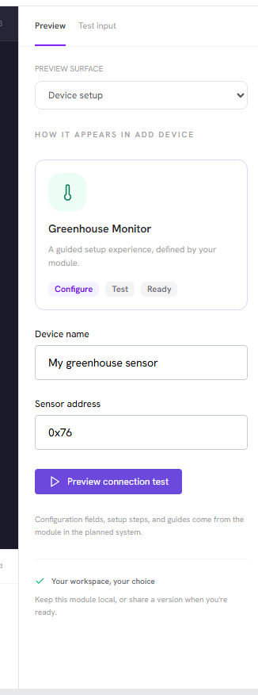

Focus: A schema becomes a setup experience

- **Preview before activation:** See the fields and guidance an operator would encounter when adding a device.
- **Keep the UI consistent:** Modules contribute configuration and instructions to the existing app experience.
- **Separate preview from execution:** A visual preview is not proof that a sensor, driver or host action works.

**Takeaway:** The demo renders a fixed example; real hardware acceptance belongs in the implementation.

Speaker notes:

Slide 7: 05 / Preview device setup

Screenshot: screenshots/05-device-schema-preview.png. Original demo capture; no generated UI artwork.

Preview before activation: See the fields and guidance an operator would encounter when adding a device.
Keep the UI consistent: Modules contribute configuration and instructions to the existing app experience.
Separate preview from execution: A visual preview is not proof that a sensor, driver or host action works.

## 08. 06 / Preview a hardware capability

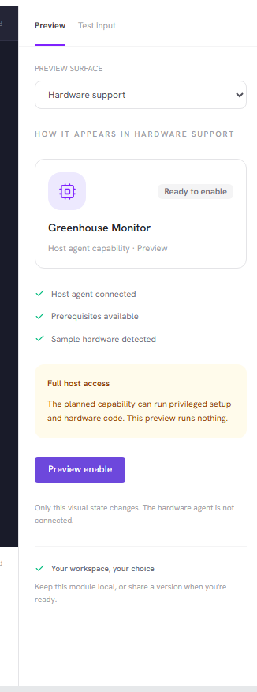

Focus: Hardware support is a module contribution

- **Declare lifecycle actions:** Hardware packages need setup, enable/disable, status and cleanup behavior.
- **Full host access is intentional:** A privileged extension is trusted host software, not sandboxed code.
- **Show the operational outcome:** Explain prerequisites, failures, reboot needs and what uninstall can leave behind.

**Takeaway:** Process supervision manages operation; it does not contain malicious root code.

Speaker notes:

Slide 8: 06 / Preview a hardware capability

Screenshot: screenshots/06-hardware-preview.png. Original demo capture; no generated UI artwork.

Declare lifecycle actions: Hardware packages need setup, enable/disable, status and cleanup behavior.
Full host access is intentional: A privileged extension is trusted host software, not sandboxed code.
Show the operational outcome: Explain prerequisites, failures, reboot needs and what uninstall can leave behind.

## 09. 07 / Test, validate and package a revision

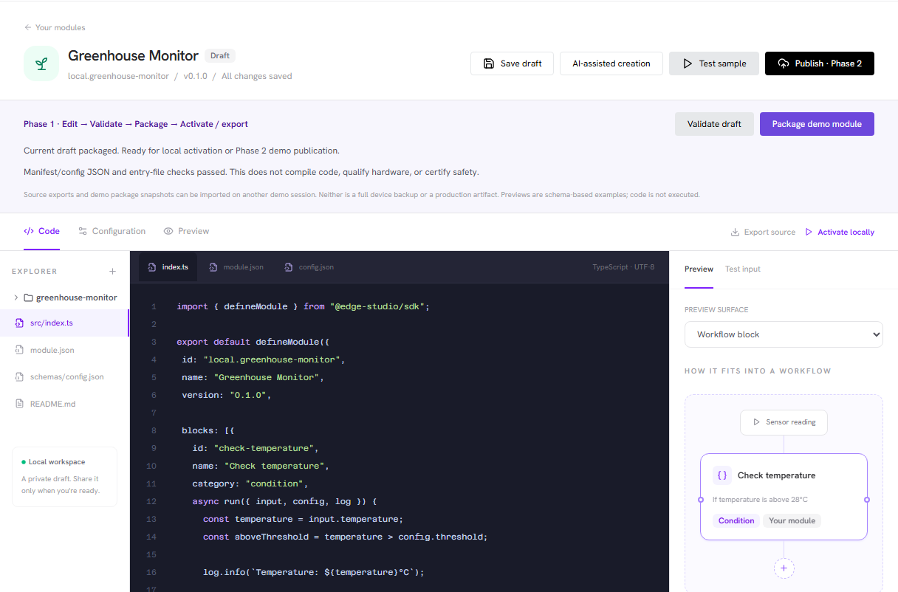

Focus: A visible preparation sequence

- **Try sample inputs:** Preview representative outputs and inspect logs before activation.
- **Validate package structure:** Check metadata, configuration and entry points; deeper implementation checks follow the runtime contract.
- **Package the exact revision:** Code or metadata changes invalidate preparation and require a fresh package.

**Takeaway:** The demo performs JSON/entry checks and exports a snapshot; it never compiles or executes code.

Speaker notes:

Slide 9: 07 / Test, validate and package a revision

Screenshot: screenshots/07-validated-package.png. Original demo capture; no generated UI artwork.

Try sample inputs: Preview representative outputs and inspect logs before activation.
Validate package structure: Check metadata, configuration and entry points; deeper implementation checks follow the runtime contract.
Package the exact revision: Code or metadata changes invalidate preparation and require a fresh package.

## 10. 08 / Back up before changing the device

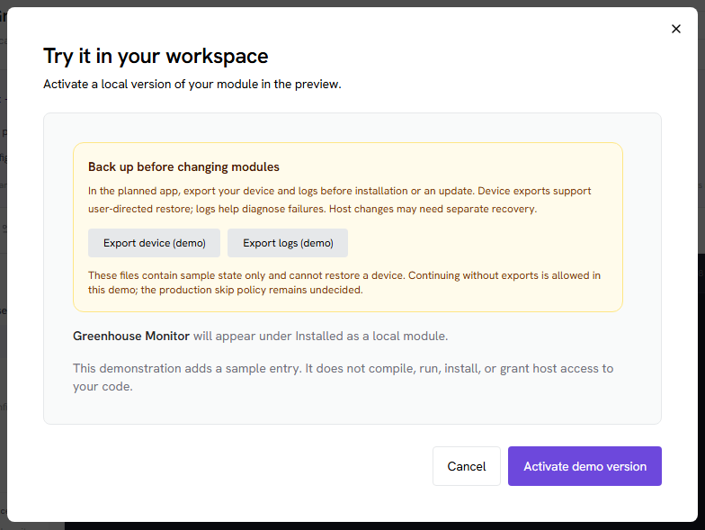

Focus: Device export plus diagnostic logs

- **Prompt before execution:** Offer device and log exports before install/update hooks or local activation.
- **Restore managed state:** The planned app-wide device backup must have a tested restore path.
- **Be precise about coverage:** Logs are diagnostic. App backups do not universally undo OS, firmware or hardware changes.

**Takeaway:** These demo downloads are explicitly non-restorable samples; the production skip policy remains open.

Speaker notes:

Slide 10: 08 / Back up before changing the device

Screenshot: screenshots/08-backup-before-activation.png. Original demo capture; no generated UI artwork.

Prompt before execution: Offer device and log exports before install/update hooks or local activation.
Restore managed state: The planned app-wide device backup must have a tested restore path.
Be precise about coverage: Logs are diagnostic. App backups do not universally undo OS, firmware or hardware changes.

## 11. 09 / Activate locally and retain control

Focus: Installed is different from active

- **Activate explicitly:** A library installation first adds an inactive package; the operator chooses when to activate.
- **Keep lifecycle actions manual:** Enable, disable and update through clear user actions.
- **Preserve useful state:** Removal retains device/workflow configuration and history unless deletion is explicitly requested.

**Takeaway:** The local builder remains usable with no production library connection.

Speaker notes:

Slide 11: 09 / Activate locally and retain control

Screenshot: screenshots/09-local-activation.png. Original demo capture; no generated UI artwork.

Activate explicitly: A library installation first adds an inactive package; the operator chooses when to activate.
Keep lifecycle actions manual: Enable, disable and update through clear user actions.
Preserve useful state: Removal retains device/workflow configuration and history unless deletion is explicitly requested.

## 12. 10 / Share directly between instances

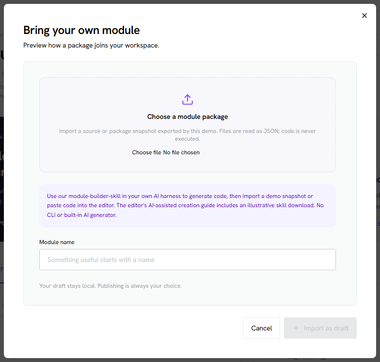

Focus: A package is not a device backup

- **Export source or a package:** Prepare a shareable module without exporting configured credentials or device history.
- **Import on another instance:** Prove author independence without publishing or changing core source.
- **Keep three artifacts distinct:** Source, installable packages and complete device backups serve different purposes.

**Takeaway:** Demo source/package JSON snapshots round-trip locally; production package formats are still to be defined.

Speaker notes:

Slide 12: 10 / Share directly between instances

Screenshot: screenshots/10-local-import-export.png. Original demo capture; no generated UI artwork.

Export source or a package: Prepare a shareable module without exporting configured credentials or device history.
Import on another instance: Prove author independence without publishing or changing core source.
Keep three artifacts distinct: Source, installable packages and complete device backups serve different purposes.

## 13. 11 / Discover a module in the hosted library

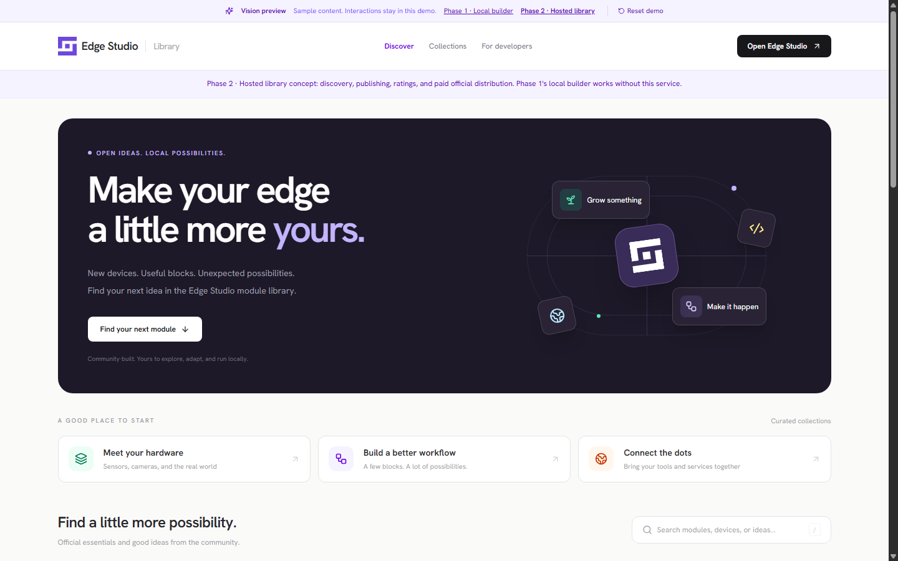

Focus: A public ecosystem around local packages

- **Find capabilities:** Search by module and contribution type rather than waiting for a core release.
- **Understand the publisher:** Publisher profiles, module ratings, aggregate builder ratings and downloads provide context.
- **Retain operator choice:** Inspect a release and its requested access before adding it to the device.

**Takeaway:** Ratings and download counts describe popularity and experience; they do not certify safety.

Speaker notes:

Slide 13: 11 / Discover a module in the hosted library

Screenshot: screenshots/14-library-discovery.png. Original demo capture; no generated UI artwork.

Find capabilities: Search by module and contribution type rather than waiting for a core release.
Understand the publisher: Publisher profiles, module ratings, aggregate builder ratings and downloads provide context.
Retain operator choice: Inspect a release and its requested access before adding it to the device.

## 14. 12 / Inspect the exact release source

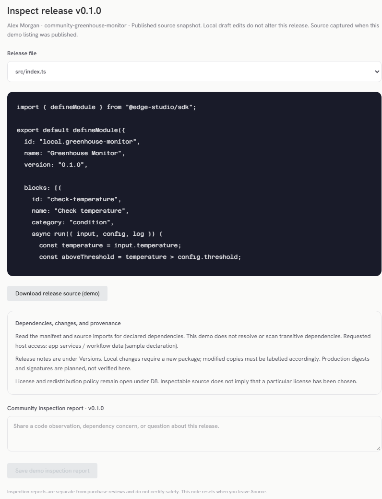

Focus: Published source and community inspection

- **Inspect a versioned snapshot:** The published release remains unchanged when an author later edits a local draft.
- **Review dependencies and access:** Read the manifest, source and release notes; provenance must match the installed artifact.
- **Separate the signals:** Inspection reports are distinct from ratings and verified-purchase reviews.

**Takeaway:** Seeded source is illustrative; this newly published example captures the actual demo draft text.

Speaker notes:

Slide 14: 12 / Inspect the exact release source

Screenshot: screenshots/13-release-source.png. Original demo capture; no generated UI artwork.

Inspect a versioned snapshot: The published release remains unchanged when an author later edits a local draft.
Review dependencies and access: Read the manifest, source and release notes; provenance must match the installed artifact.
Separate the signals: Inspection reports are distinct from ratings and verified-purchase reviews.

## 15. 13 / Publish after automated acceptance checks

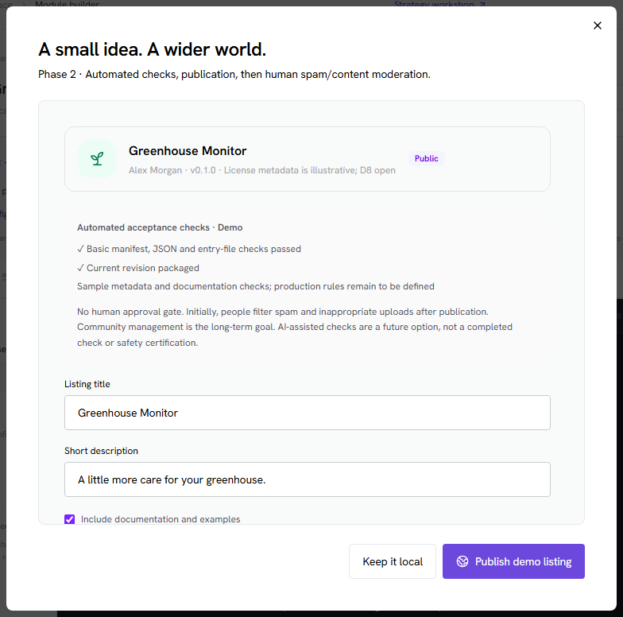

Focus: No human approval gate

- **Package first:** Publication uses a prepared revision plus metadata and documentation.
- **Run acceptance checks:** Automated checks precede publication; exact production rules still need definition.
- **Acknowledge the contents:** The author confirms their right to share; this is not a manual reviewer approval.

**Takeaway:** AI-assisted checks are an option to evaluate, not an implemented safety guarantee.

Speaker notes:

Slide 15: 13 / Publish after automated acceptance checks

Screenshot: screenshots/11-publishing-checks.png. Original demo capture; no generated UI artwork.

Package first: Publication uses a prepared revision plus metadata and documentation.
Run acceptance checks: Automated checks precede publication; exact production rules still need definition.
Acknowledge the contents: The author confirms their right to share; this is not a manual reviewer approval.

## 16. 14 / Community feedback after publication

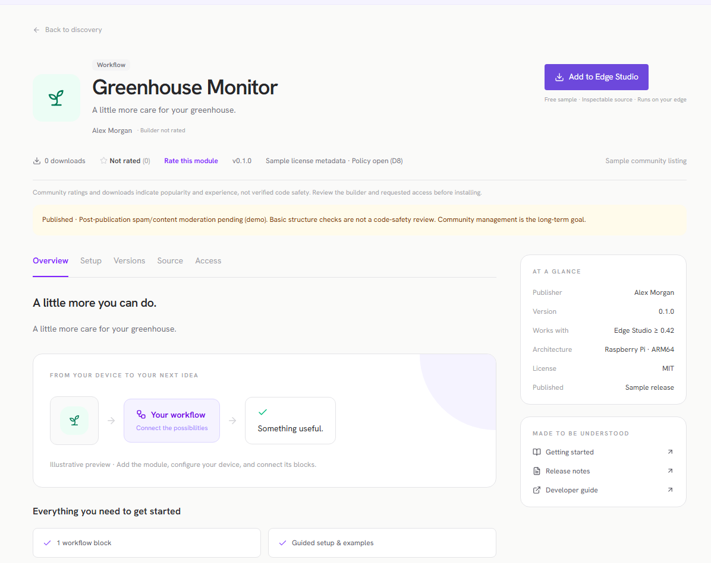

Focus: Immediate listing, later content moderation

- **Initial rollout:** Human moderation after publication filters spam and inappropriate uploads.
- **Long-term operating model:** Community-managed inspection, reports and moderation supported by automation.
- **Separate service ownership:** The web library is maintained separately from community module creation.

**Takeaway:** Named moderation owners, removal rules and transition criteria still need agreement.

Speaker notes:

Slide 16: 14 / Community feedback after publication

Screenshot: screenshots/12-community-listing.png. Original demo capture; no generated UI artwork.

Initial rollout: Human moderation after publication filters spam and inappropriate uploads.
Long-term operating model: Community-managed inspection, reports and moderation supported by automation.
Separate service ownership: The web library is maintained separately from community module creation.

## 17. 15 / Paid official distribution, inspectable source

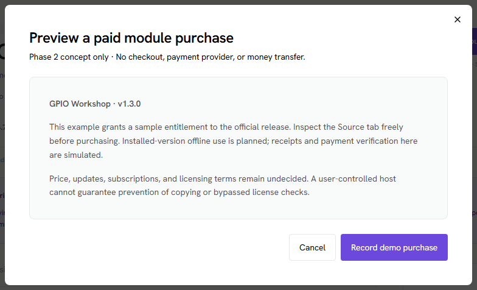

Focus: Entitlements without strong copy protection

- **Inspect before purchasing:** Source remains inspectable; publisher identity and release provenance matter.
- **Use installed versions offline:** The direction supports local entitlements without continuous license-server access.
- **Commerce is part of Phase 2:** Paid distribution is required. Pricing, provider, subscription and redistribution/fork policies still need definition.

**Takeaway:** This is a simulated purchase. No money, checkout service or verified receipt is involved.

Speaker notes:

Slide 17: 15 / Paid official distribution, inspectable source

Screenshot: screenshots/15-paid-module-concept.png. Original demo capture; no generated UI artwork.

Inspect before purchasing: Source remains inspectable; publisher identity and release provenance matter.
Use installed versions offline: The direction supports local entitlements without continuous license-server access.
Commerce is part of Phase 2: Paid distribution is required. Pricing, provider, subscription and redistribution/fork policies still need definition.

## 18. Delivery: local value first, hosted services second

The phase boundary is agreed. The public service is not a prerequisite for local use.

- **PHASE 1 / M1 → M2 → M3:** Lifecycle proof; Default-capability parity; Independent local authoring proof

- **PHASE 2 / M4:** Hosted catalog and publishing; Source inspection and reputation; Moderation and required commerce

**Takeaway:** The Phase 1 demo library is a lifecycle-test fixture, not the production publishing service.

Speaker notes:

Slide 18: Delivery: local value first, hosted services second

App-wide device/log export and tested restore are an enabling dependency for D7. M3 may begin once M1 contracts are usable and run alongside migration, but calendar estimates below conservatively avoid assuming free parallel capacity.

## 19. How to read the development estimates

Bottom-up planning ranges based on scope; low confidence until the first lifecycle slice works.

- **CAPACITY / Two full-time engineers:** One backend/runtime/hardware focus; one frontend/tools focus. Part-time QA/hardware and infrastructure support available.

- **MEASUREMENT / Effort, then elapsed time:** One engineer-week is five focused workdays. Raw elapsed weeks = effort ÷ 2. Scheduling envelopes add about 20% for interruptions/integration.

- **INCLUDED / Delivery, not just code:** Engineering review, automated tests, docs, integration and representative Pi acceptance are included in effort. The current frontend demo is reused.

- **EXCLUDED / Separate budgets and scope:** No fully featured IDE, in-app AI harness, module CLI, arbitrary custom UI, universal hardware qualification or managed automatic rollback. Ongoing library operations are separate.

**Takeaway:** No start date, staffing commitment or budget is implied. Re-estimate after M1.

Speaker notes:

Slide 19: How to read the development estimates

These are original engineering judgments, not the workshop's ordinal resource scores or industry benchmarks. Two engineers are an explicit assumption pending stakeholder confirmation. QA/infrastructure availability is assumed, not counted as a zero-cost service; their separate staffing/cost is not estimated here. AI usage is not assigned an unsupported productivity multiplier.

## 20. Phase 1 estimates: prove local extensibility

Engineering effort includes testing and integration; elapsed ranges assume two dedicated engineers.

| Milestone / enabling work | Engineer-weeks | Raw elapsed | Acceptance evidence |
| --- | --- | --- | --- |
| App-wide backup/restore prerequisite | 6–10 | 3–5 weeks | Export managed state + logs; restore on a test device. |
| M1 · Contracts + lifecycle slice | 8–12 | 4–6 weeks | HTTP/Fetch removal, real demo download, activation and restart. |
| M2 · Default capability parity | 16–24 | 8–12 weeks | Hardware/devices/blocks extracted; Pi parity and missing states. |
| M3 · Local authoring proof | 10–16 | 5–8 weeks | New sensor/block from another author; package and install elsewhere. |

**Takeaway:** Phase 1 total: 40–62 engineer-weeks · 20–31 raw weeks · about 24–38 scheduled weeks.

Speaker notes:

Slide 20: Phase 1 estimates: prove local extensibility

M1 covers capability inventory, contracts, local storage/installer/supervisor foundation and one vertical slice. M2 covers hardware supervisor migration, device registries, workflow dispatch, legacy-ID/state migration and parity/failure tests. M3 covers editing, templates, skill guidance, schema previews, test/log tooling, packaging/import/export and independent-author acceptance. Backup/restore is app-wide work, not a module-specific replacement. If delivered by another team, subtract its 6–10 engineer-weeks from this team's Phase 1 effort but retain the integration dependency. No overlap is subtracted from this total.

## 21. Phase 2 estimates: library and commerce

All three M4 work packages are included in the Phase 2 baseline.

| M4 work package | Engineer-weeks | Raw elapsed | Acceptance evidence |
| --- | --- | --- | --- |
| M4a · Hosting + self-service publishing | 10–16 | 5–8 weeks | Accounts, immutable artifacts, checks, listings and app delivery. |
| M4b · Reputation + community tools | 6–10 | 3–5 weeks | Ratings, builder aggregates, counters, inspection and report flows. |
| M4c · Required commerce | 8–14 | 4–7 weeks | Checkout, contributor payouts, refunds and offline entitlement. |
| M4 total · Includes commerce | 24–40 | 12–20 weeks | Publish, inspect, buy, install and continue installed-version use offline. |

**Takeaway:** Phase 2 total: 24–40 engineer-weeks · 12–20 raw weeks · about 15–24 scheduled weeks.

Speaker notes:

Slide 21: Phase 2 estimates: library and commerce

M4a includes production-service setup, backups/monitoring and app-library integration, but not continuous operation after launch. M4b includes implementing post-publication moderation/reporting tools, not indefinite reviewer staffing. M4c commerce is REQUIRED in Phase 2. Its estimate assumes one established payment provider, a simple purchase model and agreed policies. Subscriptions, strict copy enforcement, multi-provider payments, hosted builds and automated AI review pipelines are not included. Legal/accounting policy, payment-provider approval and commercial terms are unestimated dependencies, not hidden zero-cost work.

## 22. A planning envelope, not a promised launch date

Conservative sequential arithmetic; no unsupported overlap or AI productivity discount.

- **PHASE 1 · LOCAL BUILDER / 40–62 engineer-weeks:** Includes device export/restore prerequisite. Two engineers: about 24–38 scheduled weeks.

- **PHASE 2 · LIBRARY + COMMERCE / 24–40 engineer-weeks:** Includes checkout, contributor payouts and offline entitlements. Two engineers: about 15–24 scheduled weeks.

**Takeaway:** Both phases: 64–102 engineer-weeks · 32–51 raw weeks · about 39–62 scheduled weeks.

Speaker notes:

Slide 22: A planning envelope, not a promised launch date

Totals include the app-wide backup/restore prerequisite. Ranges are sums of milestone ranges, not calibrated statistical confidence intervals. They are not fixed commitments or monetary quotes. Reuse of existing backup work or scope reductions can reduce effort; unknown hardware/migration requirements can increase it. Sustainable operating staffing is separate from development effort.

## 23. Validate the first slice before committing the full build

The next estimate should be grounded in implementation evidence, not a closer radar polygon.

- **PROVE / M1 acceptance:** Remove → download → install inactive → activate → restart. Preserve existing configuration/history and expose missing-module states.

- **RESOLVE / Cross-app dependencies:** App-wide support policy, export/restore coverage and recovery route, module/runtime contracts and named owners.

- **DECIDE / Phase 2 implementation policies:** Commerce is required. Define provider/purchase terms, redistribution policy, publication checks and moderation ownership.

**Takeaway:** Proposed checkpoint: review M1 evidence, re-estimate M2–M4, then confirm the next funding/staffing step.

Speaker notes:

Slide 23: Validate the first slice before committing the full build

No funding, staffing or delivery-date commitment is implied by this deck. D1–D7 directions have qualifications; D8, detailed purchase/provider terms, checks/ownership and the backup skip policy remain open. Commerce is required within Phase 2. The source plan and workshop revision are the current references, not the older stakeholder deck.
